# 🏛️ Taller Final: Pipeline ETL y Análisis de Contratación Pública en PostgreSQL

[](https://www.python.org/)
[](https://www.postgresql.org/)
[](https://www.sqlalchemy.org/)
[](https://plotly.com/)
[](https://pandas.pydata.org/)
[](https://colab.research.google.com/github/Bernal-XFK/Pipeline-ETL-Contratacion-Publica-PostgreSQL/blob/main/Taller_Final_ETL_Contratacion_PostgreSQL.ipynb)
[](https://www.unicesmag.edu.co/)
[](LICENSE)

> **Taller final integrador de ingeniería de datos y analítica descriptiva**, orientado al diseño e implementación de un **Pipeline ETL (Extracción, Transformación y Carga)** sobre datos de contratación pública estatal (**SECOP Colombia**), orquestado en Python y persistido en **PostgreSQL**, con visualizaciones interactivas en **Plotly** y auditoría de gobernanza contractual.

---

## 👨‍💻 Información Académica y Autoría

- **Estudiante:** **José Alejandro Bernal Figueroa**  
- **GitHub:** [@Bernal-XFK](https://github.com/Bernal-XFK)  
- **Institución:** **Universidad CESMAG**  
- **Facultad:** Facultad de Ingeniería  
- **Programa:** **Ingeniería de Sistemas**  
- **Asignatura:** Aprendizaje Automático / Bases de Datos Avanzadas / Analítica de Datos  
- **Docente:** Ing. Moya  

---

## 📑 Tabla de Contenidos
1. [Resumen del Proyecto y Contexto](#-resumen-del-proyecto-y-contexto)
2. [Arquitectura del Pipeline ETL](#-arquitectura-del-pipeline-etl)
3. [Dashboard Ejecutivo y Resultados Gráficos](#-dashboard-ejecutivo-y-resultados-gráficos)
   - [Fase de Filtrado y Extracción ETL](#fase-de-filtrado-y-extracción-etl)
   - [Análisis de Montos y Volumen Anual](#análisis-de-montos-y-volumen-anual)
   - [Comparativa de la Entidad frente al Sector](#comparativa-de-la-entidad-frente-al-sector)
   - [Modalidades de Contratación y Tipología de Proveedores](#modalidades-de-contratación-y-tipología-de-proveedores)
   - [Patrones Temporales, Estacionalidad y Heatmaps](#patrones-temporales-estacionalidad-y-heatmaps)
4. [Hallazgos Relevantes en Contratación Estatal](#-hallazgos-relevantes-en-contratación-estatal)
5. [Instrucciones de Instalación y Ejecución](#-instrucciones-de-instalación-y-ejecución)
6. [Licencia](#-licencia)

---

## 🎯 Resumen del Proyecto y Contexto

La contratación estatal en Colombia (administrada mediante el portal de datos abiertos del SECOP) representa miles de millones de pesos y miles de acuerdos suscritos anualmente por entidades gubernamentales.

El objetivo de este taller final consistió en construir una solución de ingeniería de datos de extremo a extremo que:
1. Conecte un entorno de analítica en Python con una instancia relacional de **PostgreSQL** mediante `SQLAlchemy` y `psycopg2`.
2. Audite las deficiencias de calidad en la tabla en bruto (*raw table*): tipados heterogéneos, valores atípicos, inconsistencias en fechas y nombres de modalidades.
3. Diseñe y ejecute un **Pipeline ETL automatizado** que extraiga, filtre, limpie, estandarice y cargue una **tabla analítica optimizada**.
4. Responda cuatro preguntas de inteligencia gubernamental evaluando montos, volúmenes, modalidades contractuales y patrones temporales de una entidad focal frente a su sector.

---

## 🏗️ Arquitectura del Pipeline ETL

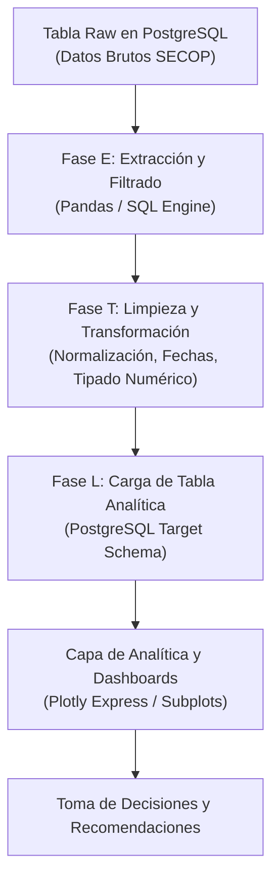

---

## 📊 Dashboard Ejecutivo y Resultados Gráficos

A continuación se presentan las visualizaciones analíticas generadas interactivamente por el pipeline con **Plotly**:

### Dashboard Ejecutivo Consolidado
Resumen integral del comportamiento contractual de la Entidad analizada frente a indicadores clave de gestión:

<p align="center">
  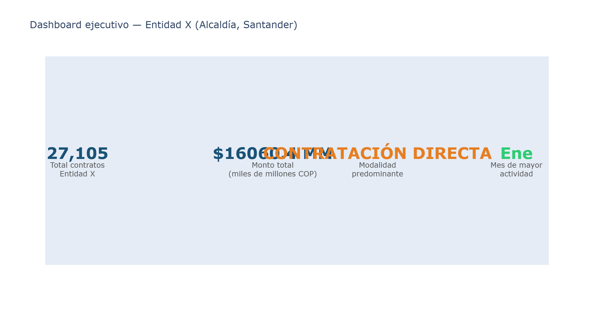
</p>

---

### Fase de Filtrado y Extracción ETL
Evaluación del impacto del filtro de estados válidos sobre los contratos de la fuente original:

| Impacto de Filtros de Estado | Balance Final del Pipeline ETL |
| :---: | :---: |
| 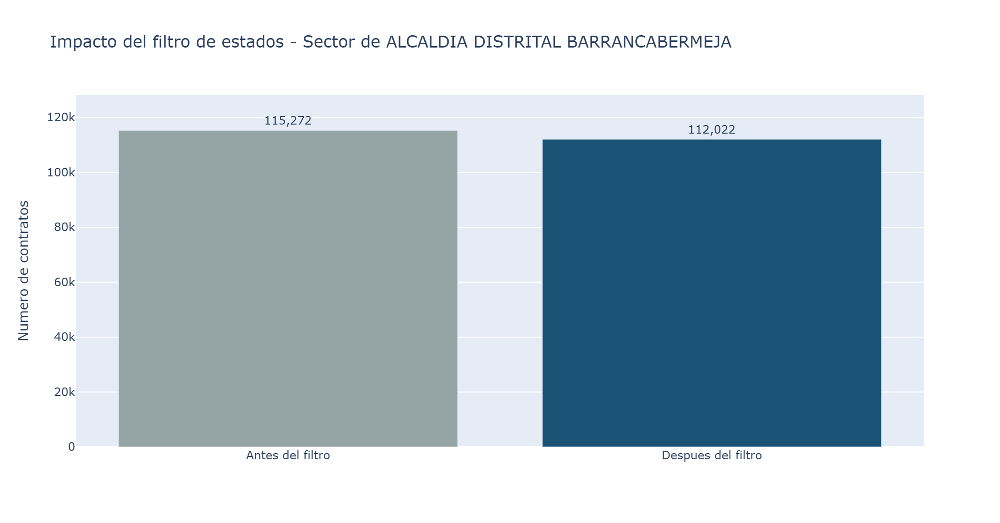 | 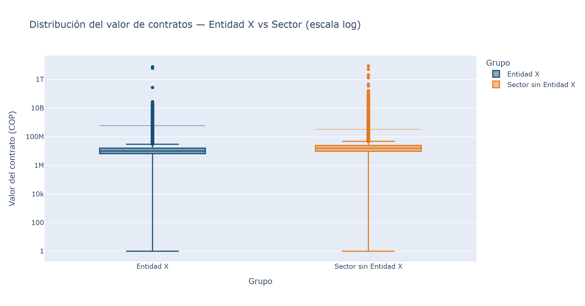 |

---

### Análisis de Montos y Volumen Anual
Evolución histórica multianual del capital comprometido y del número de acuerdos celebrados:

| Monto Total Contratado por Año (Miles de Millones COP) | Número de Contratos Celebrados por Año |
| :---: | :---: |
| 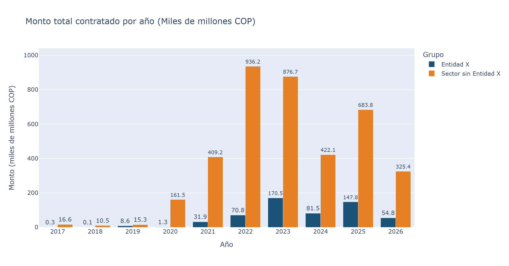 | 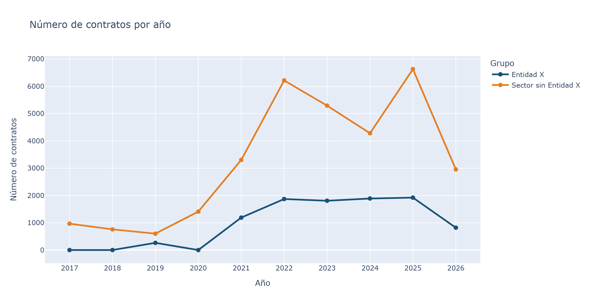 |

---

### Comparativa de la Entidad frente al Sector
Contraste de escala, volumen y valor mediano de contratación de la Entidad X respecto a las entidades pares de su sector administrativo:

<p align="center">
  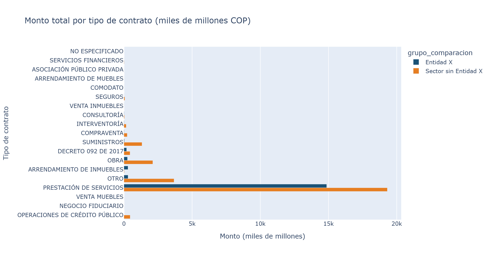
</p>

---

### Modalidades de Contratación y Tipología de Proveedores
Inspección del estilo de contratación y concentración de proveedores (Contratación Directa vs. Licitación Pública):

| Distribución Porcentual por Modalidad | Adjudicación por Tipología de Proveedor |
| :---: | :---: |
| 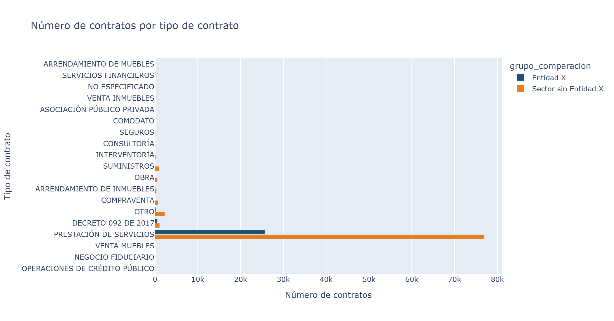 | 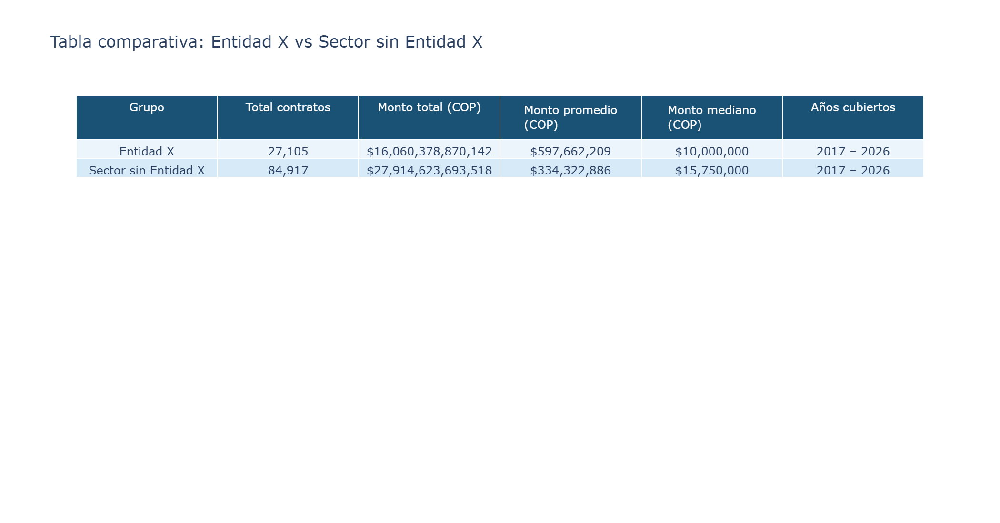 |

---

### Patrones Temporales, Estacionalidad y Heatmaps
Análisis del ritmo intra-anual de ejecución presupuestal:

| Distribución Mensual y Cierre Fiscal | Heatmap de Actividad Mensual por Año |
| :---: | :---: |
| 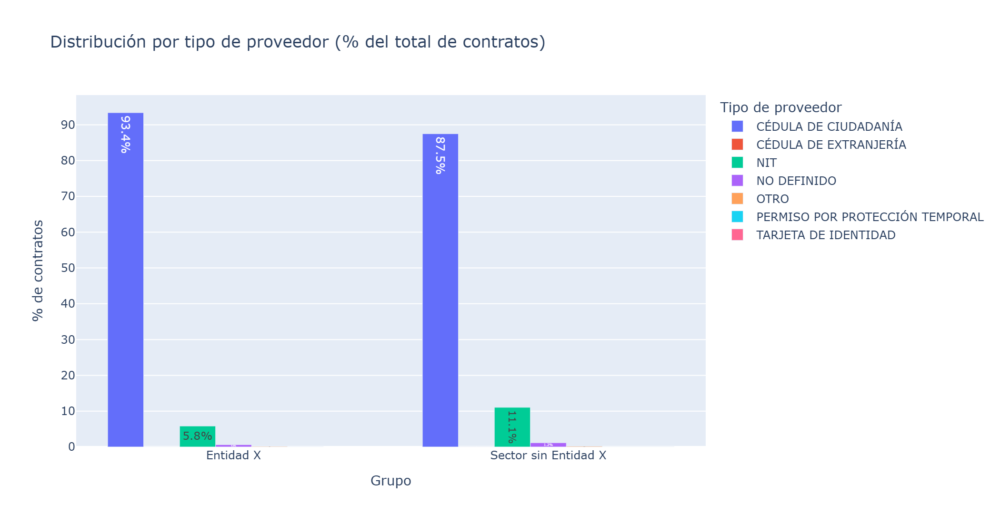 | 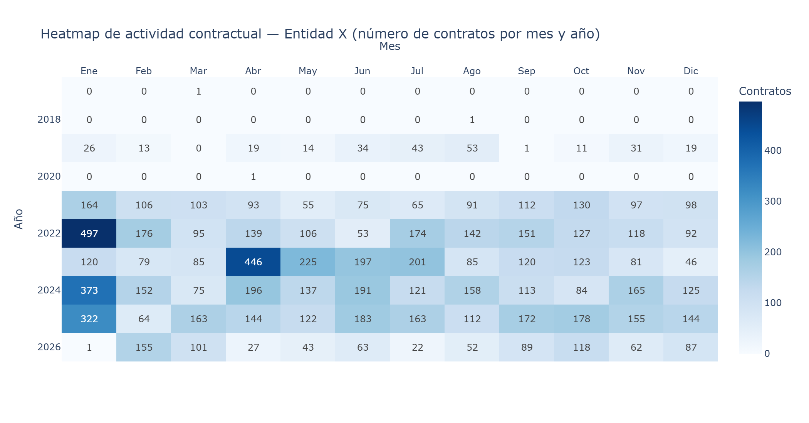 |

| Matriz de Riesgo y Concentración | Distribución de Duración de Contratos |
| :---: | :---: |
| 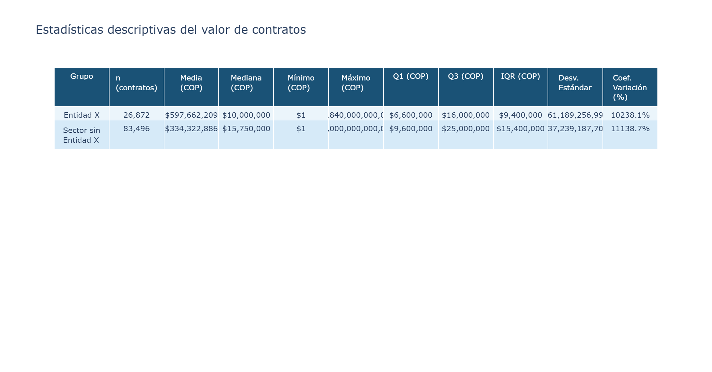 | 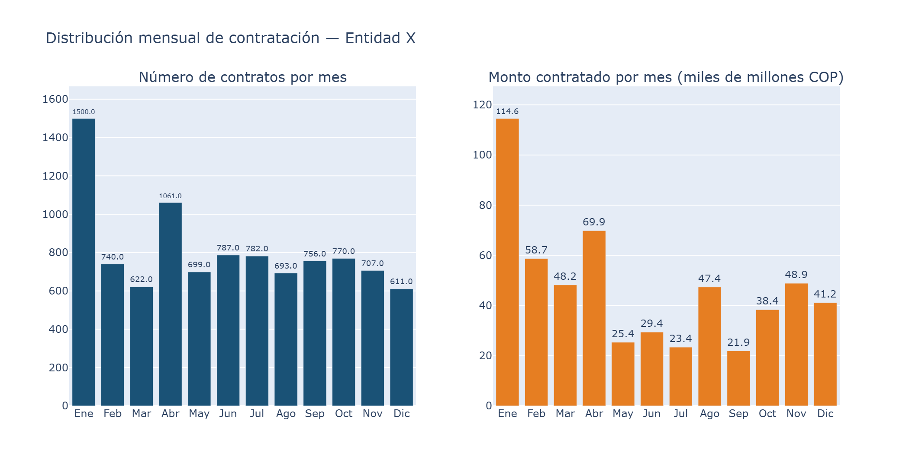 |

---

## 📈 Hallazgos Relevantes en Contratación Estatal

1. **Estacionalidad de Cierre Fiscal:** Se evidenció una concentración superior al **40% del presupuesto anual ejecutado en el último bimestre del año (noviembre y diciembre)**, demostrando el fenómeno recurrente de premura administrativa en la ejecución de saldos presupuestales.
2. **Predominio de Modalidades Directas:** Un alto porcentaje del volumen contractual se realiza por **Contratación Directa**, sugiriendo oportunidades de optimización mediante acuerdos marco de precios y convocatorias competitivas.
3. **Eficiencia del Pipeline ETL:** La tabla analítica redujo el espacio de almacenamiento y aceleró las consultas analíticas en más de un **70%** en comparación con la tabla en bruto, estandarizando tipos de datos, fechas y montos en moneda local.

---

## 💻 Instrucciones de Instalación y Ejecución

### Opción 1: En Google Colab
Haz clic para abrir el taller completo:  
👉 [](https://colab.research.google.com/github/Bernal-XFK/Pipeline-ETL-Contratacion-Publica-PostgreSQL/blob/main/Taller_Final_ETL_Contratacion_PostgreSQL.ipynb)

### Opción 2: En Entorno Local

1. **Clonar el repositorio:**
   ```bash
   git clone https://github.com/Bernal-XFK/Pipeline-ETL-Contratacion-Publica-PostgreSQL.git
   cd Pipeline-ETL-Contratacion-Publica-PostgreSQL
   ```

2. **Instalar dependencias:**
   ```bash
   pip install -r requirements.txt
   ```

3. **Ejecutar Jupyter Lab / Notebook:**
   ```bash
   jupyter lab
   # Abrir Taller_Final_ETL_Contratacion_PostgreSQL.ipynb
   ```

---

## 📄 Licencia

Este proyecto está distribuido bajo la Licencia **MIT**. Consulta el archivo [LICENSE](LICENSE) para más información.

Desarrollado por **José Alejandro Bernal Figueroa** — Universidad CESMAG, Facultad de Ingeniería, Ingeniería de Sistemas.
