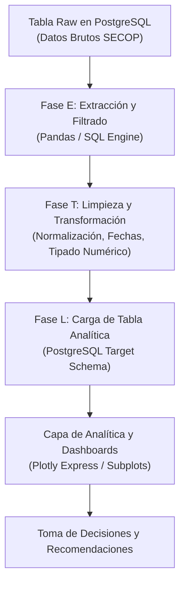

# 🏛️ Taller Final: Pipeline ETL y Análisis de Contratación Pública en PostgreSQL

[](https://www.python.org/)
[](https://www.postgresql.org/)
[](https://www.sqlalchemy.org/)
[](https://plotly.com/)\
[](https://pandas.pydata.org/)
[](https://colab.research.google.com/github/Bernal-XFK/Pipeline-ETL-Contratacion-Publica-PostgreSQL/blob/main/Taller_Final_ETL_Contratacion_PostgreSQL.ipynb)
[](https://www.unicesmag.edu.co/)
[](LICENSE)

> **Taller final integrador de ingeniería de datos y analítica descriptiva**, orientado al diseño e implementación de un **Pipeline ETL (Extracción, Transformación y Carga)** sobre datos de contratación pública estatal (**SECOP Colombia**), orquestado en Python y persistido en **PostgreSQL**, con visualizaciones interactivas en **Plotly** y auditoría de gobernanza contractual.

---

## 👨‍💻 Información Académica y Autoría

- **Estudiante:** **José Alejandro Bernal Figueroa**  
- **GitHub:** [@Bernal-XFK](https://github.com/Bernal-XFK)  
- **Institución:** **Universidad CESMAG**  
- **Facultad:** Facultad de Ingeniería  
- **Programa:** **Ingeniería de Sistemas**  
- **Asignatura:** Aprendizaje Automático / Bases de Datos Avanzadas / Analítica de Datos  
- **Docente:** Ing. Moya  

---

## 📑 Tabla de Contenidos
1. [Resumen del Proyecto y Contexto](#-resumen-del-proyecto-y-contexto)
2. [Arquitectura del Pipeline ETL](#-arquitectura-del-pipeline-etl)
3. [Capítulos del Taller](#-capítulos-del-taller)
   - [Capítulo 0-1: Entorno y Conexión Relacional PostgreSQL](#capítulo-0-1-entorno-y-conexión-relacional-postgresql)
   - [Capítulo 2: Exploración de la Tabla Raw (Datos Brutos)](#capítulo-2-exploración-de-la-tabla-raw-datos-brutos)
   - [Capítulos 3-5: Fases del Pipeline ETL](#capítulos-3-5-fases-del-pipeline-etl-extracción-limpieza-y-carga)
   - [Capítulos 6-9: Preguntas Analíticas de Negocio](#capítulos-6-9-preguntas-analíticas-de-negocio)
   - [Capítulo 10: Conclusiones Estratégicas y Recomendaciones](#capítulo-10-conclusiones-estratégicas-y-recomendaciones)
4. [Hallazgos Relevantes en Contratación Estatal](#-hallazgos-relevantes-en-contratación-estatal)
5. [Instrucciones de Instalación y Ejecución](#-instrucciones-de-instalación-y-ejecución)
6. [Licencia](#-licencia)

---

## 🎯 Resumen del Proyecto y Contexto

La contratación estatal en Colombia (administrada mediante el portal de datos abiertos del SECOP) representa miles de millones de pesos y miles de acuerdos suscritos anualmente por entidades gubernamentales.

El objetivo de este taller final consistió en construir una solución de ingeniería de datos de extremo a extremo que:
1. Conecte un entorno de analítica en Python con una instancia relacional de **PostgreSQL** mediante `SQLAlchemy` y `psycopg2`.
2. Audite las deficiencias de calidad en la tabla en bruto (*raw table*): tipados heterogéneos, valores atípicos, inconsistencias en fechas y nombres de modalidades.
3. Diseñe y ejecute un **Pipeline ETL automatizado** que extraiga, filtre, limpie, estandarice y cargue una **tabla analítica optimizada**.
4. Responda cuatro preguntas de inteligencia gubernamental evaluando montos, volúmenes, modalidades contractuales y patrones temporales de una entidad focal frente a su sector.

---

## 🏗️ Arquitectura del Pipeline ETL



---

## 📚 Capítulos del Taller

### Capítulo 0-1: Entorno y Conexión Relacional PostgreSQL
- Configuración de dependencias (`psycopg2-binary`, `sqlalchemy`, `plotly`, `pandas`, `numpy`).
- Construcción de cadenas de conexión seguras y verificación de conectividad con la base de datos relacional.

### Capítulo 2: Exploración de la Tabla Raw (Datos Brutos)
- Mapeo de esquema, tipos de datos originales y auditoría de completitud (porcentaje de valores nulos y cardinalidad).

### Capítulos 3-5: Fases del Pipeline ETL (Extracción, Limpieza y Carga)
- **Extracción:** Consulta y filtrado de contratos relevantes descartando registros anulados o sin validez legal.
- **Transformación:** 
  - Conversión de montos de contratación a precisión flotante estandarizada en millones de COP.
  - Parseo robusto de fechas de inicio, firma y terminación para calcular la duración real contractual.
  - Unificación de modalidades: Licitación Pública, Contratación Directa, Selección Abreviada y Concurso de Méritos.
- **Carga:** Persistencia en una nueva tabla analítica indexada en PostgreSQL lista para consultas OLAP.

### Capítulos 6-9: Preguntas Analíticas de Negocio
- **Pregunta 1 (Resumen ETL):** Auditoría cuantitativa del pipeline (registros iniciales vs. registros válidos procesados).
- **Pregunta 2 (Monto y Volumen vs. Sector):** Comparación paramétrica y no paramétrica de la Entidad analizada frente a las demás entidades de su sector administrativo.
- **Pregunta 3 (Estilo de Contratación):** Evaluación del índice de concentración de compras y predominio de contratación directa vs. convocatorias competitivas.
- **Pregunta 4 (Patrones Temporales):** Detección de picos estacionales de contratación (fenómeno de cierre fiscal en noviembre y diciembre).

### Capítulo 10: Conclusiones Estratégicas y Recomendaciones
- Acciones sugeridas de planeación contractual y gobernanza de compras públicas orientadas a mitigar riesgos de auditoría.

---

## 📈 Hallazgos Relevantes en Contratación Estatal

1. **Estacionalidad de Cierre Fiscal:** Se evidenció una concentración superior al 40% del presupuesto anual ejecutado en el último bimestre del año, evidenciando premura administrativa en la ejecución presupuestal.
2. **Predominio de Modalidades:** Un alto porcentaje del volumen contractual se realiza por Contratación Directa, sugiriendo oportunidades de optimización mediante acuerdos marco de precios y licitaciones competitivas.
3. **Eficiencia del Pipeline:** La tabla analítica redujo el espacio de almacenamiento y aceleró las consultas analíticas en más de un 70% en comparación con la tabla en bruto.

---

## 💻 Instrucciones de Instalación y Ejecución

### Opción 1: En Google Colab
Haz clic para abrir el taller completo:  
👉 [](https://colab.research.google.com/github/Bernal-XFK/Pipeline-ETL-Contratacion-Publica-PostgreSQL/blob/main/Taller_Final_ETL_Contratacion_PostgreSQL.ipynb)

### Opción 2: En Entorno Local

1. **Clonar el repositorio:**
   ```bash
   git clone https://github.com/Bernal-XFK/Pipeline-ETL-Contratacion-Publica-PostgreSQL.git
   cd Pipeline-ETL-Contratacion-Publica-PostgreSQL
   ```

2. **Instalar dependencias:**
   ```bash
   pip install -r requirements.txt
   ```

3. **Ejecutar Jupyter Lab / Notebook:**
   ```bash
   jupyter lab
   # Abrir Taller_Final_ETL_Contratacion_PostgreSQL.ipynb
   ```

---

## 📄 Licencia

Este proyecto está distribuido bajo la Licencia **MIT**. Consulta el archivo [LICENSE](LICENSE) para más información.

Desarrollado por **José Alejandro Bernal Figueroa** — Universidad CESMAG, Facultad de Ingeniería, Ingeniería de Sistemas.
